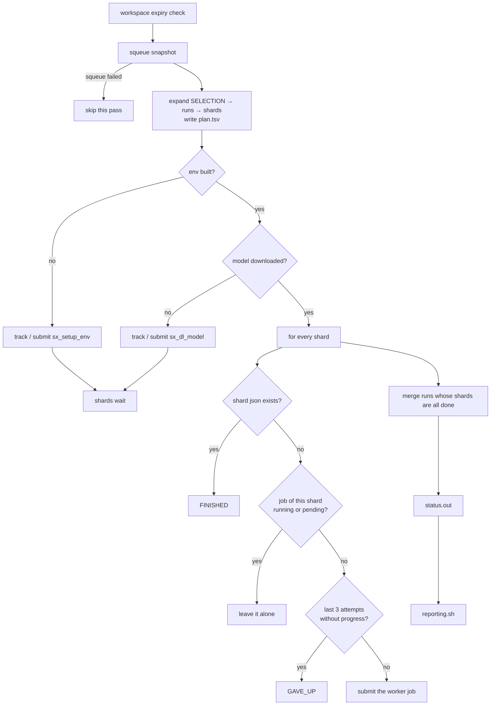

# Running Sela_beat

`Sela_beat.sh` is a CPU-only Slurm job that runs for 24 hours. Every hour it
walks the whole experiment matrix, submits what is missing, resubmits what
died, merges what is complete and refreshes the report. About ten minutes
before its own time limit it submits a fresh copy of itself. You start it once
and it keeps going. It follows the structure of Disentangling-Reasoning's
`script/heart_beat.sh`.

## What one pass does



1. **Prerequisites.** The environment and each model are prerequisites, each
   built by its own Slurm job that is tracked like any other (journal, adopt
   by name, stall protection). While they are pending, the next check comes
   after `PREREQ_INTERVAL` (10 min) instead of an hour.
2. **Plan.** The SELECTION block is expanded into runs and shards
   ([how](selection.md#how-the-plan-is-expanded)) and written to `plan.tsv`.
3. **Shards.** One shard = one GPU job = a contiguous range of problems of one
   run. A shard is finished when `shards/shard_<i>of<n>.json` exists.
   Otherwise the journal's job id is looked up in the queue: running or
   pending jobs are left alone; dead ones are resubmitted, and the new job
   resumes from the problems already in `.partial.jsonl`.
4. **Merge.** Runs whose shards are all finished are merged into
   `merged.json` and `summary.json`, again whenever a shard is newer than the
   summary.
5. **Status and report.** `status.out` is rewritten; with `AUTO_REPORT=1`,
   `reporting.sh` regenerates `result/selar_report.md`.

## Starting and stopping

```bash
cd ~/SeLaReasoning
./Sela_beat.sh --plan          # what will run (prints, writes nothing)
./Sela_beat.sh --dry-run       # one pass, WOULD SUBMIT lines, writes nothing
sbatch Sela_beat.sh            # start the heart beat
```

Submit from inside the repository. The job finds the repository through
`SLURM_SUBMIT_DIR`, or failing that through the path the job was submitted
with. Its own `#SBATCH` header requests `sgpu_medium`, 24 h, 2G, no GPU.

To stop everything:

```bash
scancel -u $USER -n sela_beat                                       # the heart beat
squeue -u $USER -h -o '%i %j' | awk '$2 ~ /^sx_/ {print $1}' | xargs -r scancel   # its jobs
```

Cancelled shards keep their partial results; the next heart beat resumes them.

## Flags

| Flag | Effect |
|---|---|
| *(none)* | the hourly loop with self re-initialisation |
| `--once` | a single real pass, then exit |
| `--dry-run` | one pass; logs `WOULD SUBMIT …` and `WOULD MERGE …`, prints the status table; writes nothing at all |
| `--status` | one pass that only reports: journal and live queue, `NEEDS RUN` lines; rewrites and prints `status.out`; submits, merges and journals nothing |
| `--plan` | prints the expanded matrix with totals and exits |
| `--plan-tsv` | the same as tab-separated values (the `plan.tsv` format) |
| `--smoke` | the [smoke test](smoke-test.md) selection in its own tree |
| `--retry-failed` | resets the stall counters of `GAVE_UP` shards and prerequisites, then continues as usual |
| `-h`, `--help` | prints the header of the script |

Internal modes, used by the jobs the heart beat submits:

| Flag | Job |
|---|---|
| `--setup-env` | builds the venv ([setup](setup.md)) |
| `--download MODEL` | downloads one model |
| `--worker ATTEMPTS -- ARGS…` | records an attempt, activates the venv, runs `scripts/sela_run.py ARGS…` |

Environment overrides: `SELA_ROOT`, `CHECK_INTERVAL` (3600 s),
`PREREQ_INTERVAL` (600 s), `SLURM_USER` (you), `TIME_LIMIT_SECONDS` (86400),
`REINIT_MARGIN` (600 s), `HF_TOKEN` (downloads).

## Editing while it runs

Edit the SELECTION, save, wait. Under Slurm the heart beat runs a copy of the
script made at submission time. At the start of every pass it compares that
copy with `Sela_beat.sh` in the repository:

- **edited and valid** (`bash -n` and `--plan` succeed): it logs
  `Sela_beat.sh was edited -> handing over …`, submits a fresh heart beat with
  the same flags (minus `--retry-failed`), and exits;
- **edited but invalid** (a typo, an unknown method, a non-numeric knob): it
  logs a warning with the validation error and keeps running the old version.

So within an hour of an edit the new selection is running, and a broken edit
never takes the pipeline down.

## Re-initialisation

At ~23 h 50 min (`TIME_LIMIT_SECONDS − REINIT_MARGIN`) the heart beat submits
a fresh Sela_beat job with the same flags and exits. Running outside Slurm,
it re-executes itself instead. With `EXIT_WHEN_DONE=1` (the smoke test's
setting) it exits for good as soon as every planned run is merged.

## Following progress

| Where | What |
|---|---|
| `$SELA_ROOT/status.out` | rewritten every pass: one row per run, with shards done, jobs running/pending, problems done, accuracy so far, a progress bar, the state |
| `./Sela_beat.sh --status` | the same, live, without changing anything |
| `$SELA_ROOT/logs/sela_beat.log` | every pass, every submission and state change, merge output |
| `$SELA_ROOT/journal.txt` | append-only history of every job |
| `$SELA_ROOT/logs/jobs/<job name>_<job id>.out` | each job's own output (stdout and stderr) |
| `result/selar_report.md` | the report, refreshed after every pass |

States in `status.out`: `MERGED`, `RUNNING`, `PENDING`, `TO_MERGE` (all
shards done, merge at the next pass), `WAITING` (nothing queued: waiting for
the environment, a model, or the next pass), `GAVE_UP(n)` (n shards stuck).

## The journal

From the smoke test of 2026-10-17:

```text
2026-10-17 01:16:53 | SUBMITTED | env::setup | job=28517939
2026-10-17 01:21:58 | FINISHED | env::setup | job=28517939
2026-10-17 01:21:58 | SUBMITTED | download::Qwen/Qwen3-0.6B | job=28518054
2026-10-17 01:22:36 | FINISHED | download::Qwen/Qwen3-0.6B | job=28518054
2026-10-17 01:24:07 | SUBMITTED | shard::Qwen3-0.6B/gsm8k/n4/selar_k3_t0.6/T0.6_p0.95_k20_mp0_L512/seed41::0of1 | job=28518075
2026-10-17 01:25:03 | MERGED | run::Qwen3-0.6B/gsm8k/n4/selar_k3_t0.6/T0.6_p0.95_k20_mp0_L512/seed41 | job=-
2026-10-17 01:31:10 | FINISHED | shard::Qwen3-0.6B/gsm8k/n4/selar_k3_t0.6/T0.6_p0.95_k20_mp0_L512/seed41::0of1 | job=28518075
```

`<timestamp> | <EVENT> | <key> | job=<id>`, one line per event. Within one
pass the shards are checked before the merge, so a shard that finishes while
a pass is running is merged in that pass and journaled `FINISHED` in the next
one, as above.

| Key | For |
|---|---|
| `shard::<run dir below runs/>::<i>of<n>` | one shard (0-based i) |
| `run::<run dir below runs/>` | a merged run |
| `env::setup` | the environment build |
| `download::<model>` | one model download |
| `retry-failed` | a `--retry-failed` reset |

| Event | Meaning |
|---|---|
| `SUBMITTED` | job submitted, id recorded |
| `RUNNING` | first pass that saw it running |
| `FINISHED` | shard file / prerequisite present |
| `DIED` | job gone from the queue without a result |
| `ADOPTED` | a live job with the expected name was found in the queue and is now tracked |
| `SUBMIT_FAILED` | `sbatch` returned no job id |
| `GAVE_UP` | stall protection stopped resubmitting |
| `MERGED` | run merged |
| `RESET` | `--retry-failed` |
| a Slurm state | e.g. `TIMEOUT`, `FAILED`, `OUT_OF_MEMORY` when squeue still shows it |

A dead job is journaled once, not again on every pass that it stays
unresubmitted.

## Job names

| Job | Name |
|---|---|
| heart beat | `sela_beat` |
| environment build | `sx_setup_env` |
| model download | `sx_dl_<model tag>`, e.g. `sx_dl_qwen38b` |
| shard | `sx_<method, 6 chars>_<dataset, 4 chars>_<model tag>_<hash>`, e.g. `sx_sem-dy_gsm8_qwen38b_a1c403` (`+` becomes `-`) |
| report (if submitted) | `sela_report` |

The model tag is the model name's letters and digits, lowercased, at most 12
characters (`Qwen3-8B` → `qwen38b`). The hash is the first 6 hex digits of
the MD5 of the shard's journal key, so names are unique and stable. That is
what makes adopt-by-name safe: a job submitted by an earlier heart beat, or
by hand with the same name, is found and tracked instead of duplicated.

## Stall protection

Every worker job first appends a line to its shard's `.attempts` file:
`<epoch> <job id> <problems already done>`. Before resubmitting, the heart
beat counts the trailing attempts that started from the **current** number of
done problems, i.e. attempts that made no progress. At `MAX_STALLED` (3) the
shard is marked `GAVE_UP` and not resubmitted. This catches crash loops (a
code error, a broken environment) without punishing a shard that is merely
killed by its time limit while making progress.

Prerequisite jobs have attempts files in `$SELA_ROOT/state/` and count every
attempt.

After fixing the cause (see the job's log in `logs/jobs/`), reset the
counters. `--retry-failed` deletes every `*.attempts` file below `runs/` and
`state/` and journals a `RESET`:

```bash
# no heart beat running: reset and do one pass right away
./Sela_beat.sh --retry-failed --once

# a heart beat is running: only delete the counters; its next pass resubmits
find /lustre/scratch/data/s76kalav_hpc-memory/selareasoning/{runs,state} -name '*.attempts' -delete
```

## Submission pacing

The cluster's controller rate-limits bursts of `sbatch`. Above a handful of
calls per second, it answers "Slurm temporarily unable to accept job, sleeping
and retrying". `sbatch` then waits on its own, which used to stall a whole
pass for minutes. The heart beat therefore:

- waits `SUBMIT_PAUSE` (1 s) between submissions,
- gives up on a single `sbatch` after `SUBMIT_TIMEOUT` (300 s); a job that got
  in anyway is adopted by name on the next pass,
- submits at most `MAX_SUBMIT_PER_PASS` (150) GPU jobs per pass; the rest
  follow at the next pass.
