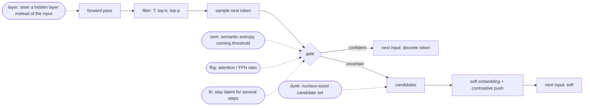

---
hide:
  - navigation
  - toc
---

# SeLaR-X

Code and pipeline for extending **SeLaR**, a training-free method that lets a
reasoning model think in continuous space *only where it is uncertain*. SeLaR-X
adds five new ideas, lets any of them be combined, and runs the whole
experiment matrix on the marvin cluster with one self-maintaining Slurm job.

## Based on

This code base is a fork of the official implementation of

> **SeLaR: Selective Latent Reasoning in Large Language Models**
> Renyu Fu, Guibo Luo · ACL 2026 (Long Papers), pp. 7073–7087 ·
> [arXiv:2604.08299](https://arxiv.org/abs/2604.08299) ·
> [GitHub](https://github.com/Parker-rfu/SeLaReasoning)

At every decoding step, SeLaR measures the entropy of the top-k candidates.
Confident steps decode normally. Uncertain steps feed the model a
probability-weighted *soft embedding* instead of a token, pushed away from the
dominant candidate so that alternatives stay alive.
[:octicons-arrow-right-24: SeLaR in one page](background/index.md)

## What this repository adds

<div class="grid cards" markdown>

-   **Five training-free extensions**

    ---

    Steering a hidden layer instead of the input, semantic entropy with a
    running threshold, multi-step latent rollouts, attention/FFN gating, and a
    nucleus-sized candidate set. All share one decoding loop and combine
    freely, e.g. `sem+dynk`.

    [:octicons-arrow-right-24: Methods](methods/index.md)

-   **One heart beat for the whole matrix**

    ---

    `Sela_beat.sh` builds the environment, downloads the models, splits every
    run into resumable GPU jobs, resubmits what dies, merges finished runs and
    refreshes the report, every hour, for as long as you let it.

    [:octicons-arrow-right-24: Running Sela_beat](guide/heart-beat.md)

-   **A report that answers the paper's question**

    ---

    `reporting.sh` writes the master comparison table of `improvement.md`,
    with paired significance tests, a ranking of the variants, the suggested
    top-2 combination, sweep tables and per-step gate diagnostics.

    [:octicons-arrow-right-24: Reporting](guide/reporting.md)

-   **Checked against the original**

    ---

    36 CPU tests show that the shared loop reproduces the authors'
    `generate_cot` and `generate_selar` token for token. They also show that
    every idea reduces to its parent method when its own knobs switch it off.

    [:octicons-arrow-right-24: Findings](findings/index.md)

</div>

## Quick start

```bash
cd ~/SeLaReasoning
./Sela_beat.sh --plan          # what the SELECTION block expands to (writes nothing)
sbatch Sela_beat.sh --smoke    # every method end-to-end on Qwen3-0.6B, about 10 minutes
sbatch Sela_beat.sh            # the real thing: hourly heart beat, keeps itself alive
./reporting.sh                 # -> result/selar_report.md (also refreshed after every pass)
```

Everything the pipeline produces is stored in
`/lustre/scratch/data/s76kalav_hpc-memory/selareasoning`. This includes the
venv, model weights, caches, per-problem results, logs and the journal. Only
the final report is written into the repository.

## One decoding step, and where each idea acts



## Documentation

| Section | What you find there |
|---|---|
| [Background](background/index.md) | the SeLaR paper, the upstream code and its batching quirk, how to compare fairly |
| [Methods](methods/index.md) | the shared loop, both baselines and all six variants, with formulas, implementation and knobs |
| [Guide](guide/index.md) | the workflow from smoke test to paper table, every option of `Sela_beat.sh`, outputs, reporting, troubleshooting |
| [Findings](findings/index.md) | what has been measured so far: equivalence tests, gate statistics, speed |
| [Reference](reference/index.md) | file map, command-line interfaces, Python API, every file format |
