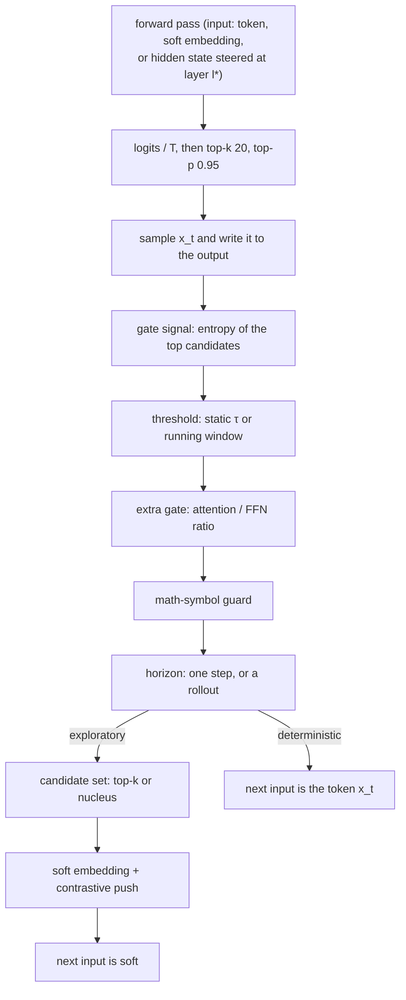

# Methods

`src/selarx.py` · one decoding loop for every method

All methods in this repository share a single function, `generate_selarx()`,
apart from the three verbatim upstream baselines. Sampling, filtering,
stopping, batching and the per-step statistics are therefore identical for
CoT, vanilla SeLaR and every variant. A difference in the results can only
come from the method itself.

## Anatomy of one step

Each idea of `improvement.md` replaces exactly one box:

| Slot | Vanilla SeLaR | Replaced by |
|---|---|---|
| gate signal | token entropy over the top-k, \(\bar H_t\) | **sem**: entropy over semantic clusters of the top candidates |
| threshold | static τ | **sem**: \(\tau_t = \max(\text{floor}, \mu_t + \gamma\sigma_t)\) over the last W steps |
| extra gate | none | **fhg**: also require attention-dominant processing, \(R_{\text{act}} > \theta\) |
| horizon | one soft step, re-decided every step | **ltr**: once started, stay soft while \(\bar H \ge \tau_{\text{exit}}\), at most M steps |
| candidate set | top-k with k = 3 | **dynk**: the smallest nucleus with mass ≥ \(p_{\text{mass}}\), \(2 \le k_t \le 8\) |
| locus | the next input embedding | **layer**: the hidden state at layer \(l^\ast\) |

Since the slots are independent, the ideas compose: `sem+dynk` uses the
semantic gate *and* the nucleus candidate set.
[:octicons-arrow-right-24: Combinations](combinations.md)

## Method names

| Name | What runs | Page |
|---|---|---|
| `cot` | the shared loop, no latent step | [Baselines](baselines.md) |
| `cot_greedy` | the same, greedy | [Baselines](baselines.md) |
| `selar` | vanilla SeLaR, gated per row | [Baselines](baselines.md) |
| `selar_upstream`, `cot_upstream`, `swir` | the authors' functions, verbatim | [Baselines](baselines.md) |
| `layer` | Variant 1 | [Layer steering](layer.md) |
| `sem` | Variant 2 | [Semantic gating](sem.md) |
| `ltr` | Variant 3 | [Latent rollouts](ltr.md) |
| `fhg` | Variant 4 | [Functional gating](fhg.md) |
| `dynk` | Variant 5 | [Dynamic k](dynk.md) |
| `a+b[+c…]` | Variant 6, any set of distinct ideas | [Combinations](combinations.md) |

In Python: `SelarXConfig.for_method("sem+dynk", sem_sim=0.85)` builds the
configuration ([API](../reference/selarx-api.md)).

## Guarantees

These are pinned down by `tests/test_selarx.py` on a tiny random Qwen3 model:

| Configuration | Equals | Meaning |
|---|---|---|
| `cot` | upstream `generate_cot` | the shared loop samples exactly like the original |
| `selar`, `soft_mask=batch_any` | upstream `generate_selar`, any batch | the gate and the soft embedding are the original's, operation for operation |
| `selar` (per row), batch size 1 | upstream `generate_selar` | per-row gating *is* Algorithm 1 |
| `layer`, α = 0 | `cot` | the hook only adds the step; the lens and gate change nothing |
| `fhg`, θ = 10⁹ | `cot` | an extra gate that never opens leaves plain decoding |
| `fhg`, θ = −1 | `selar` | an extra gate that always opens is vanilla |
| `ltr`, M = 10⁶, \(\tau_{\text{exit}} = \tau\), decay 1 | `selar` | vanilla is a rollout without horizon and hysteresis |
| `dynk`, \(k_{\min} = k_{\max} = 3\) | `selar` | a fixed-size nucleus is the top-k |

"Equals" means token for token, with the same seed. So when a variant differs
from its parent, the difference comes from the idea's own knobs.

## What every step records

Each step updates per-problem counters, which end up in the result files and
in the report's [diagnostics](../guide/reporting.md#5-latent-step-diagnostics):

| Counter | Meaning |
|---|---|
| `steps` | decoding steps (= generated tokens incl. EOS) |
| `latent` | steps with a latent intervention: soft next input, or a steered hidden state |
| `soft_inputs` | soft inputs actually fed; larger than `latent` only with `batch_any` |
| `gate_open` | steps whose entropy passed the threshold, before the guard and fhg |
| `guarded` | openings blocked by the math-symbol guard |
| `vetoed` | openings blocked by fhg |
| `rollouts`, `commits` | ltr: rollouts started, rollouts ended by the horizon |
| `k_sum` | dynk: sum of \(k_t\) over latent steps |
| `clusters_sum` | sem: sum of the cluster counts |
| `ratio_sum`, `ratio_n` | fhg: sum and count of \(R_{\text{act}}\) |
| `thr_sum`, `thr_n` | sem: sum and count of the dynamic threshold |
| `h_sum`, `h_sq`, `h_n`, `htok_sum`, `h_hist` | the gate's entropy: sum, sum of squares, count, token-entropy sum, 20-bin histogram |

CoT runs record the top-3 entropy as well, without acting on it, so their
entropy profile is comparable with SeLaR's.
