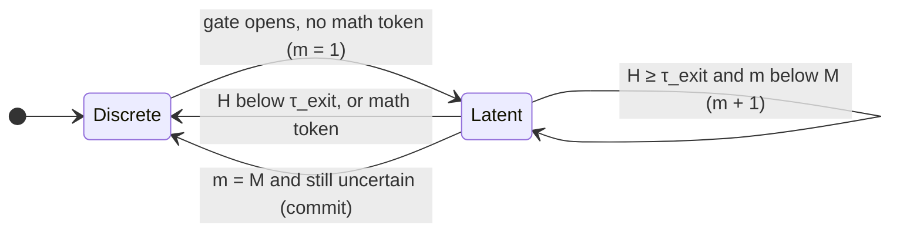

# Variant 3 · Latent rollouts

`--method ltr` · Idea 3 of `improvement.md` · horizon

Vanilla SeLaR re-decides every step: a soft step is followed by another only
if that step is uncertain enough on its own. Hard forks in a derivation often
need several steps to resolve. Latent trajectory rollouts (LTR) keep the model
in continuous space for **up to M consecutive steps** once a fork is detected,
and leave early when the uncertainty has resolved.

## Formulation

1. **Start**: at step t the gate opens (\(\bar H_t \ge \tau\), and fhg if
   combined) and the sampled token is no math symbol → rollout step m = 1.
2. **Continue** with step m + 1 while all of these hold:
   - \(\bar H \ge \tau_{\text{exit}}\) (still uncertain; \(\tau_{\text{exit}} < \tau\) gives hysteresis),
   - the sampled token is no math symbol,
   - m < M.
3. **Exit** as soon as \(\bar H < \tau_{\text{exit}}\) or a math symbol is sampled:
   the next input is discrete.
4. **Commit**: when m = M and the step is still uncertain, the next input is
   discrete. Its token is the sampled one (`LTR_COMMIT=sample`) or the argmax
   (`argmax`). After a commit, a new rollout may start at the next step.

Each soft step uses SeLaR's regularised soft embedding, with a contrastive
weight that decays over the rollout:

$$
\tilde e_{t+m-1} = e_{t+m-1} + w \cdot \delta^{\,m-1} \cdot \bar H_{t+m-1} \cdot \hat\Delta_{t+m-1} \cdot \lVert \Delta_{t+m-1} \rVert
$$

with \(w\) = `CONTRASTIVE_W`, \(\delta\) = `LTR_DECAY`.

!!! info "Vanilla SeLaR is a special case"
    With M = ∞, \(\tau_{\text{exit}} = \tau\) and decay 1, a rollout continues
    exactly while the gate would have opened anyway. The test
    `test_ltr_without_horizon_or_exit_is_selar` checks the token equality.

## Implementation

The state machine lives in `_Gate.decide`: a per-row counter `roll` (0 = not
in a rollout, m ≥ 1 = soft step m). The entropy tested against
\(\tau_{\text{exit}}\) is the gate's entropy, i.e. the semantic one in
`sem+ltr`. `rollouts` and `commits` are counted per problem; the report shows
rollouts per problem and the average rollout length (latent steps ÷ rollouts).

With `layer`, a "rollout" means consecutive **steered** steps, and the
steering factor α decays instead of the contrastive weight. A commit is simply
an unsteered step, so `LTR_COMMIT` has no effect there.

## Knobs

| Variable | Flag | Default | Sweep | Meaning |
|---|---|---|---|---|
| `LTR_MAX` | `--ltr_max` | 3 | 2 3 4 5 | horizon M: soft steps per rollout |
| `LTR_EXIT` | `--ltr_exit` | 0.2 | 0.15 0.20 0.25 | stay latent while the entropy is at least this |
| `LTR_DECAY` | `--ltr_decay` | 0.9 | 0.8 0.9 1.0 | contrastive weight × decay^(m−1) |
| `LTR_COMMIT` | `--ltr_commit` | `sample` | sample | token written when the horizon forces a commit |

The entry threshold is the base gate's τ (`SELAR_PRESET`).

## What the smoke test showed

52.8 rollouts per problem with an average length of 1.61 steps; 16.6% latent
steps against 12.5% for vanilla. Most rollouts end after one or two steps,
because uncertainty rarely persists. M = 3 is therefore seldom the binding
constraint, and \(\tau_{\text{exit}}\) is.
